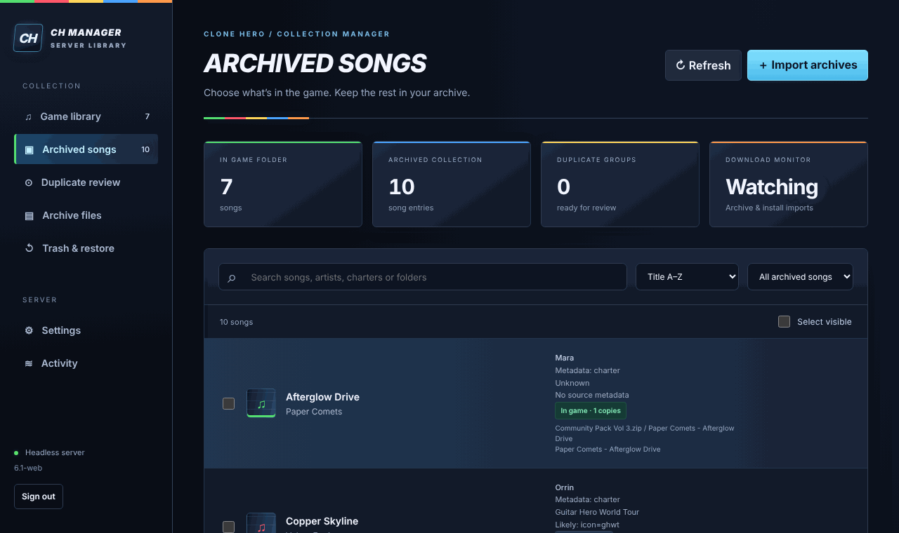

# 🎸 CH Manager Pro — Server Library

A self-hosted web app for managing a [Clone Hero](https://clonehero.net/) song library from a home server, NAS or always-on PC. Drop in chart packs, keep every original download as an archive, and choose which songs are actually in the game, from any browser, including your phone.



Clone Hero itself runs elsewhere (a gaming PC or Steam Deck) and plays from the song folder this server manages, shared over SMB/NFS. The app only manages files; it never needs the game to be open.

> **Looking for the desktop app?** The original GTK4 desktop version for Linux/Steam Deck is kept on the [`desktop`](https://github.com/Nailima-AI/CH-Manager-Pro/tree/desktop) branch.

## Features

- **Import packs**: upload ZIP, RAR, 7z, TAR (`.tar`, `.tar.gz`/`.tgz`, `.tar.bz2`/`.tbz2`, `.tar.xz`/`.txz`) or native `.sng` files from the browser, or let the app watch a downloads folder.
- **Archive first, install later**: originals are kept in an archive folder. Browse the songs inside every pack and install only the ones you want; remove them from the game later without losing the download.
- **No duplicate installs**: a song whose full content (charts, audio, metadata) is already in the game is never copied again, even from a re-downloaded pack.
- **Duplicate review**: compare identical copies, same chart with different audio/metadata, and same title/artist with different charts, across the game folder and your archives. Nothing is deleted automatically.
- **Organize**: move songs into artist, charter, source-game or custom folders, after reviewing a full preview of every move.
- **Charter and source-game detection** with evidence labels (see [Metadata detection](#metadata-detection)).
- **Recoverable Trash**: removed songs and archives go to the app's Trash and can be restored. There is no permanent-delete button.
- **Phone-friendly**: bottom navigation, large touch targets and a layout tested from 320 px phones to desktop widths.

## Quick start

### Docker Compose (recommended)

```bash
git clone https://github.com/Nailima-AI/CH-Manager-Pro.git
```

```bash
cd CH-Manager-Pro && docker compose up -d --build
```

```bash
docker compose exec ch-manager cat /data/access-token
```

Open `http://127.0.0.1:8899` on the server and sign in with that token. The image includes 7-Zip with the RAR codec.

By default all data, including songs and archives, lives in a Docker volume. To use real folders on your server, uncomment the example mounts in [`compose.yaml`](compose.yaml) and enter the container paths (`/songs`, `/archives`, `/downloads`) in **Settings**. The container runs as UID 1000, so those folders must be writable by that user. An NFS volume example is included too.

### Plain Python

Python 3.10+ with **no third-party packages**. Install `7zip` (or `p7zip`) for RAR and 7z support:

```bash
sudo apt install 7zip
```

```bash
python3 ch_web.py
```

The sign-in token is created on first start:

```bash
cat ~/.local/share/ch_manager_web/access-token
```

A sample systemd unit is in [`deploy/ch-manager-web.service`](deploy/ch-manager-web.service).

### Reaching it from another device

The server listens on localhost only. From your computer, use an SSH tunnel and open `http://127.0.0.1:8899`:

```bash
ssh -L 8899:127.0.0.1:8899 user@your-server
```

For LAN or reverse-proxy access, see [Networking](HEADLESS.md#lan-or-reverse-proxy-access). Don't expose the app directly to the internet.

## Playing the songs in Clone Hero

1. Share the server's song folder with the gaming device (SMB/NFS) and mount it there.
2. Add the mounted folder to Clone Hero's song folders in its settings.
3. After installing, moving or removing songs in the web app, run **Scan Songs** in Clone Hero.

The archive folder can stay on the server; Clone Hero never needs to see it.

## Configuration

Folders, folder organization, download watching and whether new imports install automatically are set in the app's **Settings** page. Server options are command-line flags:

| Option | Default | Purpose |
| --- | --- | --- |
| `--data-dir` | `~/.local/share/ch_manager_web` (or `$CH_WEB_DATA`) | Settings, token, Trash, uploads |
| `--host` | `127.0.0.1` | Listen address; use `0.0.0.0` only with `--allowed-hosts` |
| `--port` | `8899` | Listen port |
| `--allowed-hosts` | `localhost,127.0.0.1,[::1]` | Hostnames the browser may use |
| `--secure-cookie` | off | Set when serving over HTTPS through a proxy |
| `--max-upload-mib` | `2048` | Largest accepted upload per file |
| `CH_WEB_TOKEN` env var | generated | Use your own sign-in token (24+ characters) |

## Resource use

Measured with 3,000 installed songs and 20 archives holding 500 more:

| | CPU | Memory |
| --- | --- | --- |
| Idle, watch folder on | ~0.02% of one core | ~50 MB |
| Page open | ~0.1% of one core | ~50 MB |
| Startup scan | ~6 s of one core, once | ~50 MB |
| Refresh after a change | ~0.5 s | ~55 MB |

Library work runs one job at a time, so it uses at most about one core (plus a `7z` process while unpacking RAR/7z files). **Plan for temporary disk space:** to browse inside your archives, the app keeps them unpacked in the temp directory while it runs, which takes at least as much space as the archives themselves.

## Metadata detection

| Field | Sources, in priority order |
| --- | --- |
| Title / artist | `song.ini` `[song]` fields, then `notes.chart` `[Song]` fields |
| Charter | `charter`, `frets`, then `author` |
| Source game | `game`, `source_game` or `source` fields (unverified); known Guitar Hero/Rock Band `icon` values; a recognizable parent pack-folder name |

Icon and folder matches are labeled **Likely**: a custom chart can reuse an official game's icon. This is local metadata only; there is no audio recognition or online lookup. Songs are folders containing `notes.chart`, `notes.mid` or `notes.midi`, or native SNGPKG v1 `.sng` files.

## Limitations

- No Clone Hero process detection, and no downloading from links (Google Drive etc.): upload files or use the watch folder.
- One user, one token sign-in. No accounts or OIDC; put it behind a reverse proxy with its own login if you need that.
- Removing a single song from inside a multi-song pack isn't supported; packs are never rewritten.
- Re-encoded audio or MIDI isn't recognized as identical; those show up as possible duplicates for manual review.
- Extraction isn't a malware sandbox: links, path traversal and executables are refused, but only import packs you trust.
- Tested on x86-64 Linux. Other CPU architectures and actual Clone Hero playback from a network share haven't been verified here.

## More documentation

[HEADLESS.md](HEADLESS.md) is the full guide: every page of the web interface, reverse proxies, Docker and systemd details, how duplicate review and SNG files work, and how refresh and recovery behave.

## Development

```bash
python3 -m unittest discover -s tests -v
```

The tests run a real HTTP server against temporary folders. Tests needing `7z`, `rar` or GTK skip themselves when those aren't installed. CI ([`.github/workflows/tests.yml`](.github/workflows/tests.yml)) also builds the Docker image and runs an end-to-end smoke test in it, and runs Playwright layout checks at five screen sizes.

| File | What it is |
| --- | --- |
| `ch_web.py` | Web server, sign-in and the background job queue |
| `library_core.py` | Scanning, archive extraction, hashing, install/move/remove (shared with the desktop app) |
| `web/` | The browser interface: plain HTML, CSS and JavaScript, no build step |
| `ch_manager_pro.py`, installer | The legacy GTK desktop app; see the `desktop` branch |

## License and credits

[MIT](LICENSE). Forked from [aledibe94/CH-Manager-Pro](https://github.com/aledibe94/CH-Manager-Pro); original copyright and attribution are retained. This fork's changes are AI-generated and AI-assisted code: review them, and back up your song and archive folders before pointing the app at your main library.
